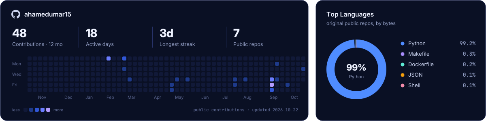

 

 

<h2><picture><source media="(prefers-color-scheme: light)" srcset="assets/headers/stack-light.svg" /></picture></h2>

  

<h2><picture><source media="(prefers-color-scheme: light)" srcset="assets/headers/stats-light.svg" /></picture></h2>

  

  <a href="https://linkedin.com/in/ahamed-umar">LinkedIn</a> &nbsp;·&nbsp;
  <a href="mailto:ahamedumar825@gmail.com">ahamedumar825@gmail.com</a> &nbsp;·&nbsp;
  <a href="https://github.com/ahamedumar15?tab=repositories">All repositories</a>

<picture><source media="(prefers-color-scheme: light)" srcset="assets/footer-light.svg" /></picture>
