 

 

<h2><picture><source media="(prefers-color-scheme: light)" srcset="assets/headers/stack-light.svg" /></picture></h2>

In my public repos you can see Python, LangChain, LangGraph, Gemini, ChromaDB, FastAPI, Streamlit, SQLite, Pytest, Playwright, Selenium, mypy, Ruff, Docker, GitHub Actions, Prometheus and Grafana at work. The rest of the stack is from coursework and work outside GitHub.

  

<h2><picture><source media="(prefers-color-scheme: light)" srcset="assets/headers/work-light.svg" /></picture></h2>

**[Personal PDF Chatbot](https://github.com/ahamedumar15/personal-pdf-chatbot)** &nbsp;

A RAG app for asking questions about your own PDFs. It answers from the pages or says it couldn't find the answer, and every claim links back to a file, page and chunk.

- **The problem.** Most RAG demos hallucinate when the documents don't cover the question, cite vaguely, and give you nothing to debug.
- **Refusal is enforced in three places.** If no chunk clears the similarity threshold, a fixed refusal sentence comes back *without calling the model*. The system prompt and the context framing back that up, and a test checks the sentence character for character.
- **Citations you can trust.** Text is split per page, so every `[S1]` marker resolves to one real page number. Retrieval can run as similarity, MMR (the default) or hybrid dense + BM25 fused with RRF.
- **Observable and measurable.** A retrieval inspector shows the scores and per-stage latency for each answer. There are Prometheus metrics with a provisioned Grafana dashboard, and an offline eval harness measures context recall, faithfulness, citation validity and refusal accuracy.
- **Engineering.** Clean Architecture with one composition root. Deterministic fake providers let 530+ tests run offline. Six CI jobs cover lint, strict mypy, a test matrix (3.12/3.13, Ubuntu and Windows), a security scan, a Docker smoke test and a final gate.

Python · LangChain (LCEL) · LangGraph · Gemini · ChromaDB · FastAPI + SSE · Streamlit · SQLite · Docker · Prometheus · Grafana · MIT

Screenshot: chat with inline citations

 

 

**[CrunchFlow](https://github.com/ahamedumar15/crunchflow)** &nbsp;

An installable Claude Code plugin that runs AI coding like a governed software team. The rules live in deterministic hook scripts, not in prompts the model could argue with.

- **The problem.** A prompt is only a suggestion, and an AI coding agent can be talked, or can talk itself, past one.
- **Hooks as physics.** `hooks/gate.py` runs before every file write *and every Bash command*. With no approved spec, nothing gets written. Each developer task can touch only its own files, and QA can't edit the code it's grading, even through `sed -i` or `python -c`.
- **Approval bound to bytes.** Approving records `sha256(docs/02-spec.md)`. Change the spec by one byte and code writes are denied until it's restored or re-approved.
- **Measured, not self-reported.** Six of the ten spec-score checks are computed by a linter, and dashboard figures come from the append-only audit trail. [The worked example](https://github.com/ahamedumar15/crunchflow/tree/main/examples/expense-tracker) records eight real gate denials.
- **Honest boundaries.** A written [threat model](https://github.com/ahamedumar15/crunchflow/blob/main/THREAT_MODEL.md) spells out what the shell governance does *not* contain.

Python standard library (zero dependencies) · Claude Code hooks, agents and skills · unittest · CI on Ubuntu, Windows and macOS × Python 3.9–3.13 · MIT

 

**Test automation**: three frameworks where the tests are the product.

| Project | What it covers | Built with |
| --- | --- | --- |
| [demoblaze-playwright-python-framework](https://github.com/ahamedumar15/demoblaze-playwright-python-framework) | E-commerce UI flows: auth, catalog, cart and checkout, contact form. Page Object Model, pytest markers, and an [Allure report on GitHub Pages](https://ahamedumar15.github.io/demoblaze-playwright-python-framework/) | Playwright · pytest · Docker · GitHub Actions |
| [automation-exercise-framework](https://github.com/ahamedumar15/automation-exercise-framework) | Registration, login, products and cart, plus edge cases. Driver factory for Chrome, Firefox and Edge, parallel runs with xdist | Selenium · pytest · Allure |
| [dummyjson-api-automation](https://github.com/ahamedumar15/dummyjson-api-automation) | REST API suite: auth, CRUD across ten resources, negative cases and response-time checks | pytest · requests · jsonschema |

 

<h2><picture><source media="(prefers-color-scheme: light)" srcset="assets/headers/principles-light.svg" /></picture></h2>

| Principle | Where you can see it |
| --- | --- |
| **Refuse rather than guess.** | The PDF chatbot returns a fixed refusal and never calls the model when retrieval finds no evidence. |
| **Every claim needs a source.** | Per-page chunking, so each citation points to one real page, and an eval metric for citation validity. |
| **Enforce rules in code, not prompts.** | CrunchFlow's hook gate denies out-of-scope writes, including those made through a shell. |
| **Measure it; don't let the model report it.** | Offline RAG evaluation with refusal accuracy, and dashboards built from audit trails and real token counts. |
| **Make failure visible.** | Retrieval inspector, Prometheus metrics, JSON logs with request IDs, and an append-only audit log. |
| **Tests that run anywhere.** | Deterministic fake LLM providers, offline suites, and CI across operating systems and Python versions. |

 

<h2><picture><source media="(prefers-color-scheme: light)" srcset="assets/headers/stats-light.svg" /></picture></h2>

Built by <a href="scripts/build_assets.py"><code>scripts/build_assets.py</code></a> from GitHub's public contribution calendar and the languages API, and refreshed daily by a workflow. It uses no third-party stats service, so a broken or rate-limited service can't break this card.

  

  <a href="https://linkedin.com/in/ahamed-umar">LinkedIn</a> &nbsp;·&nbsp;
  <a href="mailto:ahamedumar825@gmail.com">ahamedumar825@gmail.com</a> &nbsp;·&nbsp;
  <a href="https://github.com/ahamedumar15?tab=repositories">All repositories</a>

<picture><source media="(prefers-color-scheme: light)" srcset="assets/footer-light.svg" /></picture>
